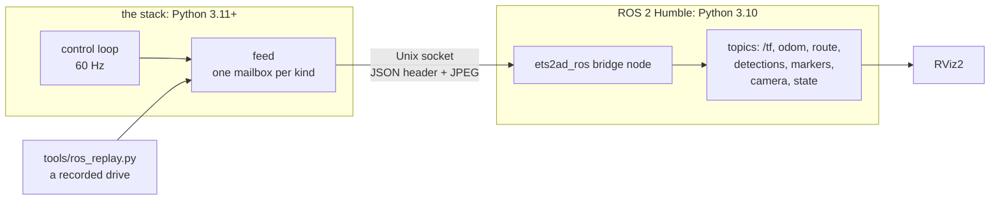

# ETS2 Autonomous Driving Stack

[](https://github.com/koculuhamit/ets2-autonomous-driving/actions/workflows/ci.yml)

https://github.com/user-attachments/assets/3ae98950-220b-4697-ba80-0c3b65493a71

A delivery to Düsseldorf on Linux, from the beacon switched on to the
depot: 62 km of the game's in 11 minutes, no take-over, no hits. The game
is on the left, its ROS 2 view in RViz on the right; parts are sped up. The
whole drive, uncut, is on [YouTube](https://youtu.be/7b_GEeqkvM8).

An external, modular autonomous driving stack for **Euro Truck Simulator 2**.

> **This is a game project.** None of this code is safe or suitable for a real
> vehicle. It uses ground-truth telemetry a real truck does not have, runs
> against a simulated world with no sensor noise, and has no functional-safety
> case at all.

## What it does

Take a job, hitch its trailer, drive out of the yard onto the road, and
switch the truck's beacon on (O). The truck then drives the delivery.

- It follows the game's own GPS route, planned from the map read out of the
  game's archives (every installed DLC, ferries and trains included), lane by
  lane, and changes lanes only where the route needs it.
- It keeps to the road's limit, with adaptive cruise control to a full stop
  and away, one give-way decision per junction, and jerk-limited pedals.
- It stops for red lights, including one it loses sight of behind a lorry,
  and moves off with the queue.
- It slows on the retarder before the brake where the truck has one, and
  learns how hard each truck brakes.
- With `--ros`, what it sees and plans is shown in RViz (ROS 2 Humble).
- At a port, a train terminal or the depot's gate it stops with its hazard
  lights on and sounds the horn twice. The driver takes the crossing, or
  parks and delivers.

Switch the beacon off at any moment and the controls are the driver's at
once. A hit, damage, or standing still too long stops the truck and hands it
over. Nothing is drawn over the game, and the game's UI is never automated.

## Status

Release 2.1.3 is 2.1.0 with the fixes found after it, on Linux and on
Windows, and an uninstaller; see the release notes of
[2.1.2](docs/release-notes-2.1.2.md) and [2.1.3](docs/release-notes-2.1.3.md).

Release 2.1.0, driven on Ubuntu 22.04: three deliveries in a row went
through without a fault to fix, to Düsseldorf, Salzburg and Linz. Since
2.0.0 it has driven 1712 km of the game's in 28 drives; what changed is in
the [release notes](docs/release-notes-2.1.0.md). Its Windows build is made
and checked by CI but has not been driven yet.

Release 2.0.0 was driven on Windows 11 until three deliveries in a row went
without a hit or a take-over: Bergen to Calais, Milan to Verona, Munich to
Nuremberg. On Ubuntu 22.04 and on Windows it was installed from its zip into
an empty folder, the way a new user would, and driven.

Earlier, on Linux, every mission recorded up to 4 October 2026 (33 drives,
4333 km of the game's) came to 0.53 interventions per 100 km, most of them
on problems fixed since, as `tools/report.py` measures them. The
[technical report](docs/report.md) has the measurements behind the design.

## Getting started

From a release (`ets2ad-<version>-<platform>.zip`), unzip it and run
`ets2ad.sh` (Linux) or `ets2ad.bat` (Windows). You install nothing first: the
launcher fetches [uv](https://docs.astral.sh/uv/) if it is missing, and uv
brings Python. The install guides for [Linux](docs/install-linux.md) and
[Windows](docs/install-windows.md) cover the game's settings.

One mod is required: [this Steam Workshop mod](https://steamcommunity.com/sharedfiles/filedetails/?id=2131396358), enabled in the
game's mod manager. It takes the collision away from toll and yard gates.
The truck drives through toll booths without stopping for their barriers,
and without the mod it would hit them.

You hand the truck over and take it back with its beacon light. The game's
key for it is O by default (or whatever key you bound to the beacon in the
game's controls). Press it once to switch the beacon on, and the autopilot
drives; press it again to switch it off, and the truck is yours at once.
Pressing the brake or the throttle also takes the truck back.

From source:

```bash
uv sync --extra perception          # or --extra perception-cpu without an NVIDIA GPU
uv run python tools/setup.py        # plugin, map, detector: does what is missing
uv run python tools/mission.py      # then the truck's beacon (O) in the game
```

`tools/setup.py` installs the plugin (restart the game after), reads the map
out of the game once per map update, and checks for the detector, which is
not in the repository: copy `data/models/dfine-nano-ets2/` from a release.
Run the game full screen at 1920x1080, with the interior camera.

| Tool | What for |
|---|---|
| `tools/mission.py` | the autopilot: engage with the beacon, job after job |
| `tools/panel.py` | a status panel in a terminal beside the game |
| `tools/calibrate.py` | measure a new truck: steering, brakes, camera, dashboard |
| `tools/report.py` | measure recorded drives: lateral error, braking, hits, interventions / 100 km |
| `tools/ros_replay.py` | play a recorded drive into the ROS 2 view |
| `tools/teach_crossing.py` | teach a junction or passage the map gets wrong, by driving it |

## Development setup

You need [uv](https://docs.astral.sh/uv/). The project pins its own Python
3.11 and leaves the system interpreter alone.

```bash
curl -LsSf https://astral.sh/uv/install.sh | UV_INSTALL_DIR="$HOME/.local/bin" sh
uv sync --extra dev
source scripts/dev-env.sh     # activates .venv and pins uv's data directories
pre-commit install
```

Run the project's tools through uv (`uv run python scripts/package.py`,
`uv run pytest`). The system's `python3` on Ubuntu 22.04 is 3.10, and they
need 3.11 or later.

Perception runs its models with ONNX Runtime, which comes as an extra:
`--extra perception` for the NVIDIA GPU build (it brings its own CUDA, about
2.5 GB), or `--extra perception-cpu`. The model is exported once with
`tools/export_detector.py`; its docstring says how.

Then:

```bash
pytest              # unit, contract and replay tests
ruff check .        # lint (includes the pathlib portability rule)
ruff format .       # format
```

Tests that need a running game or real hardware are marked and skipped by
default: `pytest -m "not game and not hardware"`.

## Architecture

```
core/       platform-independent: perception, localization, planning, control
pal/        platform abstraction layer: base + linux + windows + fake
adapters/   external interfaces: ros2 (a bridge to RViz); rest is a placeholder
tools/      calibration, data collection, analysis, map extraction
plugin/     SCS SDK telemetry plugin source (CMake, Linux + Windows)
tests/      unit, PAL contract, offline replay
docs/       install guides, release notes, technical report
configs/    YAML configuration, backed-up game settings
data/       (git-ignored) datasets, map cache, recordings
```

`core/` contains no OS-specific code. Everything that differs between Linux
and Windows lives behind `pal/`, and CI checks this by walking the AST of
`core/` for forbidden imports.

CI builds the plugin with GCC and MSVC and compares the struct layouts the
two compilers produced, field by field. The shared memory blocks are an ABI
between C++ and Python on two platforms. The layout header is written with
explicit padding and static assertions so that both compilers should agree,
and that CI job checks that they do.

### ROS 2 interface



The adapter lives in `adapters/ros2/`. Humble's `rclpy` is built for the
system's Python 3.10 and the stack runs on 3.11 or later, so the two never
share a process. The stack writes small framed messages to a Unix socket
(`wire.py`, standard library only, imported by both sides), and a ROS 2 node,
built with colcon, publishes them:

| topic | type |
|---|---|
| `/tf` | `map → base_link → eye → eye_optical`, and `map → trailer` |
| `/ets2/odom`, `/ets2/route` | `nav_msgs/Odometry`, `nav_msgs/Path` (on the road's heights) |
| `/ets2/detections` | `vision_msgs/Detection3DArray` |
| `/ets2/markers`, `/ets2/truck`, `/ets2/lanes` | `visualization_msgs/MarkerArray` |
| `/ets2/camera/image_raw/compressed`, `/ets2/camera/camera_info` | `sensor_msgs` |
| `/ets2/state` | `std_msgs/String`, JSON |

The game's axes (x east, y up, z south) are turned into REP 103's. The
control loop never waits for ROS. Each kind of message has a single slot,
and a newer one replaces one not yet sent, so a slow bridge sees fewer poses
but never stale ones. With no bridge listening, the messages are dropped.
The node only publishes and sends nothing to the game. `core/` does not
import `rclpy`, a test checks that it does not, and the drive runs the same
without ROS. `tools/ros_replay.py` plays a recorded drive into the same
topics.

### Why pure pursuit and a PI speed controller

The lateral controller is pure pursuit on the planned lane line. The speed
controller is PI with feedforward for the gradient and measured pedal maps.
No MPC, and no comparison between controllers was run. The reasons:

- **The path is known exactly.** The truck's position comes from telemetry
  and the lane from the game's own map, so there is no perception noise in
  the lateral loop for a model to filter. On a planned motorway route at
  40 km/h, pure pursuit stayed 0.089 m RMS from the lane's middle, 0.36 m at
  worst ([route_following](docs/results/route_following.md)).
- **The hard part was the actuators, not the control law.** The game takes
  a steering *rate*, not an angle. Its steering ratio is progressive, 0.112
  to 0.132. Its brake does nothing up to 0.055 and then gives 1.8 m/s² at
  once. Each of these was measured ([sysid](docs/results/sysid.md)) and
  inverted, and a better controller on top of an unmeasured plant would have
  hidden them.
- **The trailer is handled in planning.** Tight turns are planned deeper
  into the junction, so the trailer stays off the kerb. A tracking controller
  could not do that, because it follows whatever line it is given.
- **One knob with a physical meaning.** Pure pursuit's look-ahead distance,
  and its failure, cutting corners, shows plainly in a trace.

An MPC would need a model of the game's steering-rate controller and of the
trailer. It is the natural next step if the remaining trailer off-tracking
in very tight turns (R < 10 m) were worth the work.

## Platform support

| | Linux (Ubuntu 22.04, X11) | Windows 11 |
|---|---|---|
| Game discovery | driven | driven |
| Telemetry and input plugin | driven | driven (built by MSVC in CI, ABI compared) |
| Shared memory | driven | driven |
| Screen capture | driven (the game full screen) | driven |
| Release package | built, installed from the zip, driven | built, installed from the zip, driven |
| Hotkeys, overlay | not built: the beacon engages, nothing is drawn over the game | same |

The telemetry plugin also registers an input device with the game itself,
so neither platform has OS-specific input code, and a user has nothing extra
to install.

The Windows backend's Win32 calls sit behind one small class, so the logic
around them runs in the test suite on any platform against a stand-in.

The `fake` backend is complete. The test suite and offline replay run
against it, with no game, GPU or X server. Select it with
`ETS2AD_PAL_BACKEND=fake`.

## Documentation

- [Technical report](docs/report.md): the design and the measurements behind it
- [Results](docs/results/README.md): where the stack stands now, the latency
  budget, and the lab notes behind each part
- [Architecture decision records](docs/adr/)
- [Game compatibility and control mixes](docs/compat.md)
- [Border crossings](docs/borders.md)
- Install guides: [Linux](docs/install-linux.md), [Windows](docs/install-windows.md)

## Licence

MIT, see [LICENSE](LICENSE).
