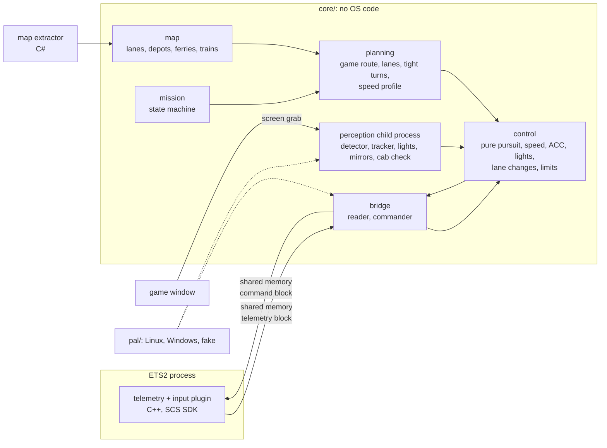

# An autopilot for Euro Truck Simulator 2: technical report

What the stack does, how it is built, how well it works, and where it still
fails. Release 2.0.0, on Linux (Ubuntu 22.04) and Windows 11.

## The problem

Drive a delivery in ETS2 the way a careful driver does. The driver takes the
job, hitches the trailer, drives out of the yard and switches the truck's
beacon on. From there the truck follows the game's own GPS route to the
depot's gate: it keeps to the speed limit, stops for lights and traffic,
gives way at junctions, changes lanes only where the route needs it, and
keeps its controls smooth. The driver can take over at any instant, and
keeps the parts a careful autopilot should not do on its own: refuelling,
ports and trains, parking and delivering.

Two constraints shape the design:

- No UI automation and nothing drawn over the game. The stack reads the game
  through its SDK and its screen, and drives through an input device the
  game itself loads.
- Telemetry gives the truck's own state exactly and nothing about other
  vehicles or traffic lights. Those come from the screen.

## Architecture

- Plugin: one C++ library publishes telemetry into shared memory at 60 Hz
  and registers a semantical input device with the game, so commands arrive
  as if from a controller. There is no virtual joystick and no OS input code
  on either platform. The shared memory layout is an ABI between C++ and
  Python on two compilers; CI builds it with GCC and MSVC and compares the
  layouts field by field.
- Map: a C# tool reads the road network out of the game's own archives with
  TruckLib, for every installed DLC, on the player's machine. Python compiles
  it into a lane graph with ferries, trains and the depots' gates.
- Route: the game's GPS route is planned on that graph with the game's own
  weighting, from the truck to the depot's gate, and checked against the
  minimap's red line. Where the two part, for a place the player marked or a
  road the map weighs differently, the red line wins. Borders and other
  places the map gets wrong are driven on a line a driver taught by driving
  it (`tools/teach_crossing.py`).
- Perception: a D-FINE nano detector fine-tuned on game frames runs in its
  own process on the GPU. A tracker turns boxes into distances on the ground
  through a calibrated camera. Traffic light colour is read from the lamp
  inside a detected signal head, and the HUD mirrors are read for vehicles
  coming up in the lane the truck is about to move into.
- Control: pure pursuit on the planned lane line, steered from the driven
  axle, with tight turns planned deeper into the junction so the trailer
  stays off the kerb; a PI speed controller with gradient feedforward on
  measured pedal maps; adaptive cruise to a stop and away; one give-way
  decision per junction; lane changes held or turned back for a vehicle in
  the target lane; and limits that stop the truck and hand it over.
- Mission: engaged by the truck's beacon. Ready, driving, crossing,
  arrived, stopped: each end leaves the truck standing with its hazard
  lights on and the driver told in the launcher's window.

## Results

Release 2.0.0 was driven on Windows 11 until three deliveries in a row had no
hit and no take-over: Bergen to Calais, Milan to Verona, Munich to Nuremberg.
On Windows and on Ubuntu the release was installed from its zip into an
empty folder, as a new user would, and driven.

Over the 33 drives recorded on Linux up to 4 October 2026, 4333 km of the
game's, the stack averaged 0.53 interventions per 100 km, with 6 hits and
167 hard brakes, measured by `tools/report.py`. Those drives came before
most of the fixes in this release.

Every drive recorded on Linux since then is summed by period in
[results](results/README.md), with the latency budget from the picture to
the brake.

Measurements behind the design:

| | |
|---|---|
| telemetry | 59.9 Hz, no retries in 495 reads; positions agree with the game's log |
| input latency | 15 to 28 ms from command to the game, one to two frames |
| screen grab | 3.3 ms median for a 1080p frame |
| speed hold | 0.101 km/h RMSE at 30 km/h |
| route following | 0.36 m worst, 0.089 m RMS from the lane's middle on a planned motorway route at 40 km/h |
| vehicle detection | recall 0.745 (pretrained 0.256), 94 % of near vehicles, 19 ms a frame |
| distance to a vehicle | scale within 1.2 %; 0.72 m RMS at 17 to 64 m |
| steering map | measured ratio from 0.112 at centre to 0.132 at lock |
| brakes | a dead zone up to 0.055, then 1.8 m/s² at once |

## Failure modes, and how the stack handles them

- A lane change into a vehicle coming up from behind. The camera looks
  ahead, so the HUD mirror on the side of the change is read before the
  change and all through it. A vehicle near in the mirror holds the change;
  one whose box grows fast holds it too, and turns a change already begun
  back while the truck is less than 1.5 m across. The mirror crop is given
  to the detector with its shape kept: stretched to the model's wide input,
  a car far back was found 0.7 s before it reached the truck, kept 1.8 s.
- A reroute that comes late. When the game picks another way just before a
  fork, the new route can put the start of a lane change behind the truck.
  The change is still made from where the truck is if the lane is clear and
  there is room, never in under 4.8 s; a change wholly behind the truck is
  left alone instead of pulling the truck back onto an old lane.
- A poster read as a red light. A red disc on an advert passes a colour
  test, so colour is read only from the lamp inside a detected signal head,
  and a head too far away to be the near stop line's is not counted.
- A light that cannot be seen. Behind a lorry the light may never show.
  The queue is watched instead: when the traffic ahead goes, the truck goes
  with it.
- A customs island crossed. The map's lanes through the booths are not the
  ones a driver uses; such places are driven on a taught line.
- The game restarted or its window moved. The launcher finds the new game's
  telemetry and window by itself, and says when the window is covered,
  minimised, or (on Linux) does not fit on the screen.
- A cache that failed only on Windows. It was keyed by `id()` of an object,
  and ids are reused; it now checks a weak reference.

## Limitations

- By night the HUD mirrors show little, and the detector misses some
  vehicles. It was measured on dusk and night frames from Italy; daylight,
  rain and fog have not been measured.
- A car coming up very fast can still reach the truck as it moves across, if
  it is not in the mirror when the change begins.
- Booths, posts and bollards are not on the map: the truck keeps its cab
  within 0.6 m of the lane's middle on the outside of a tight turn, and the
  driver takes the truck out of a yard's gate.
- Engaged at speed into a turn, the truck takes the turn wide.
- Hard braking is frequent at stops: the brake gives 1.8 m/s² at once, and
  the engine brake is the only gentler deceleration the truck has.
- Without an NVIDIA GPU perception runs on the CPU, about three times slower;
  no delivery has been driven that way.
- Buses (the Coaches DLC) are not driven.
