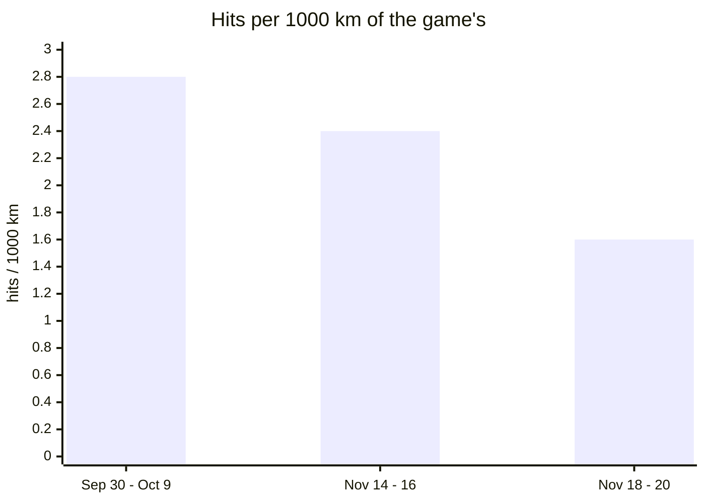
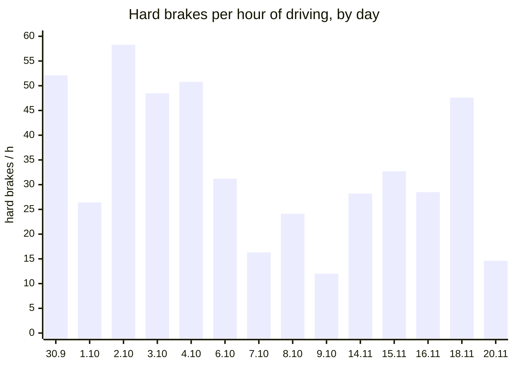

# Results

Where the stack stands, measured from every drive recorded on Linux, and
the dated lab notes it was built from.

## Where it stands

| | |
|---|---|
| recorded on Linux | 156 drives, 12 908 km of the game's, 16.2 h, 30 September to 20 November 2026 |
| releases | [2.0.0](../release-notes-2.0.0.md) on 15 November, [2.1.0](../release-notes-2.1.0.md) on 20 November |
| the bar for a release | three deliveries in a row with no hit, no take-over, and nothing to fix |
| the last delivery | Düsseldorf, 62 km in 11 minutes: no take-over, no hit, 2 hard brakes (README's video) |
| end to end, picture to brake | about 110 ms median, 165 ms p95 ([latency budget](latency_budget.md)) |

Release 2.0.0 was also driven on Windows 11; those drives are not in the
numbers here.

## By period

`tools/report.py <sessions> --json report.json`, then
`tools/analysis/phases.py report.json`:

| | drives | km | hours | deliveries | hits / 1000 km | hard brakes / h | hardest deceleration, median |
|---|---|---|---|---|---|---|---|
| Sep 30 - Oct 9: development | 79 | 7765 | 8.5 | 18 | 2.8 | 28.8 | 5.9 m/s² |
| Nov 14 - 16: release 2.0.0 | 47 | 3271 | 4.6 | 8 | 2.4 | 31.2 | 4.8 m/s² |
| Nov 18 - 20: towards 2.1.0 | 30 | 1872 | 3.1 | 5 | 1.6 | 35.3 | 4.9 m/s² |

Hits fell by 43 % from the first period to the last. The rate of hard
brakes did not fall, and the table is not a fair comparison for it. In
October the truck drove mostly long motorway runs, about 910 km of the
game's an hour. In November it drove deliveries through towns with traffic
lights, junctions and queues, 600 to 700 km an hour, and that is where hard
brakes happen. Many November drives were also short tests of a fix, run
straight after a fault.

By day, the hard brakes vary with the roads driven more than with the code:

On 18 November the drives were spent finding the hard stops at red lights
and junctions. The fixes are in 2.1.0, and the drives of 20 November had
14.6 hard brakes an hour, the lowest of November.

### What the columns mean

All of them are `core/evaluation/metrics.py`'s:

- **km**: the game's kilometres, from the truck's odometer, as the game's GPS
  and dashboard show them.
- **delivery**: a drive that reached the end of its route.
- **hit**: the truck's speed falling by 2.5 m/s within 0.15 s, which no
  brake does, or a hit the drive itself stopped for. A car running into the
  truck counts too.
- **hard brake**: over 3 m/s² for 0.3 s or more. One stop is one hard brake.
- **hardest deceleration**: for each drive of 4 minutes or more, the hardest
  braking in it, smoothed over 0.5 s; then the median across the drives.

## Lab notes

Each note was written when the part was built and measured, and is dated.
Each describes the stack as it was that day, and some numbers have changed
since. The "Phase" a note mentions is a stage of the development plan, which
is not published.

| note | what it measured |
|---|---|
| [latency_budget](latency_budget.md) | picture and telemetry to the wheels, step by step (Nov 20) |
| [telemetry_bridge](telemetry_bridge.md) | the plugin's shared memory: rate, consistency, correctness |
| [input_path](input_path.md) | command latency into the game, and the plugin's watchdog |
| [longitudinal_first_drive](longitudinal_first_drive.md) | the first time the stack moved the truck |
| [sysid](sysid.md) | system identification: steering map, pedals, gears, gradient |
| [cruise](cruise.md) | the first speed hold |
| [route_following](route_following.md) | the first steering: following a recorded line |
| [map_extraction](map_extraction.md) | reading the road network out of the game's archives |
| [route_planning](route_planning.md) | planning a route on the game's lanes |
| [map_matching](map_matching.md) | which lane the truck is on |
| [capture_bench](capture_bench.md) | grabbing the game's window |
| [vehicle_detection](vehicle_detection.md) | the detector, fine-tuned on game frames |
| [distance_estimation](distance_estimation.md) | metres to a vehicle from one camera |
| [adaptive_cruise](adaptive_cruise.md) | following a vehicle to a stop and away |
| [traffic_lights](traffic_lights.md) | lights from the map, colours from the picture |
| [steering_centring](steering_centring.md) | why the truck ran wide: the game centres the wheel |
| [metrics_baseline](metrics_baseline.md) | every drive up to 4 October, the first baseline |

The decisions behind the design are in [the ADRs](../adr/).
