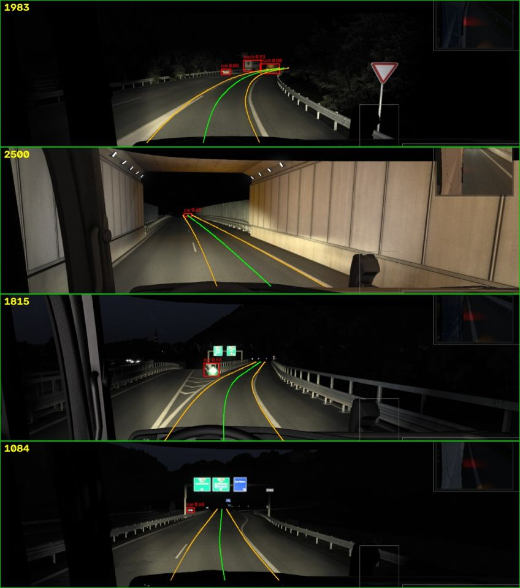

# Distance to vehicles, and the one to follow

**Date:** 2026-09-24
**Data:** the three drives of docs/results/vehicle_detection.md; everything
here is measured offline on them, with the game closed
**Code:** `core/perception/{camera,lanes,tracking}.py`,
`tools/calibrate_camera.py`, `tools/track_lead.py`, `configs/camera.json`

The detector says where vehicles are in the image. Following one needs
metres: how far ahead it is, how fast the gap closes, and whether it is in
the truck's lane at all. This page covers the camera model that turns boxes
into metres, how it was measured, and the tracker and lead-vehicle choice
built on it.

## The camera

A flat road seen through a pinhole: the row where a box meets the road gives
its distance, `focal x height / (row - horizon)`. Nothing about the camera
is in the game's config (no FOV entry) or telemetry (head *offset* only), so
`tools/calibrate_camera.py` measures it from the recordings:

| | value | how |
|---|---|---|
| horizon row | 438.3 | lane lines meeting, 144 straight frames; per drive 433–441 |
| eye height | 2.88 m | lane lines widening per row, against the map's 4.5 m lanes; per drive 2.88–2.98 |
| distance scale (focal × height) | 2359 px·m | road seen from above moving by what the telemetry says the truck moved, 684 pairs, IQR ±6 % |
| focal length | 819 px (99° horizontal FOV) | scale over height |
| eye across the cab | 0.86 m left of centre | lane lines against where the map puts the truck in its lane |

Two ways of measuring failed, and are worth knowing:

- **Focal length from turns.** Far scenery shifts by `focal x tan(yaw)` when
  the truck yaws. Per drive this gave 739, 784 and 891 px. The game turns the
  interior camera into bends by itself (`g_cam_auto_move_interior_mult 1.6`),
  so the camera's yaw is not the truck's. The measurement is kept only as the
  starting point for the road-motion one.
- **Height from a single daytime frame** gave 2.74 m. It used a partly
  visible far lane line, and the frame came from another session with the
  seat possibly elsewhere.

Checks the calibration passed:

- the road-motion scale on the clearest drive (dusk, traffic-01) alone was
  within 3 % of the calibrated one;
- the driver sits 1.52 m from the lane's left line in the daytime frame; with
  the truck centred in a 4.5 m lane and the seat 0.6–0.9 m left of centre,
  1.35–1.65 m is expected;
- the map's lane ahead, drawn through the calibrated camera, lies on the
  painted lane in bends, tunnels and at a motorway split (below).

### What it cannot do

50 m ahead is 48 px below the horizon, and 100 m ahead is 24 px. Every pixel
the horizon is off moves a car 100 m ahead by 4 m. The horizon moves when the
cab pitches, on crests and dips, and when the player looks around: across
straight frames of one drive its interquartile range was 7–19 px. Ground-
contact distance is good to a few metres inside 50 m and rough beyond 100 m.

## Tracking

`Tracker` joins boxes across frames by overlap and confirms a track after 3
sightings. It forgets a track unseen for 0.5 s.

- **Distance** is the median of the last second.
- **Closing speed** comes from how fast the box *grows*:
  `d ln(width_px)/dt = -closing / distance`. It is not the difference of
  distances. The first version differenced them, and 168 m ahead of a truck
  at 90 km/h a car came out driving backwards at 152 km/h. A cab pitching
  moves the whole box up and down; it does not change the box's width.

## The lead vehicle

The nearest confirmed track that meets all of these:

- within 2 m of the middle of the lane ahead;
- no wider than 6 m (a vehicle seen from behind);
- no further than 120 m.

A tunnel portal the detector called a truck came out 38 m wide at 150 m, and
is rejected.

**The lane comes from the map**, planned from where the telemetry puts the
truck, not from straight ahead. Straight ahead, at a motorway split, the gore
sign stood in front of the truck and became a stopped car:

*Green: the middle of the lane ahead from the map, orange: ±2 m. From the
top: a bend with a truck ahead; a tunnel; a motorway split, where the lit
gore sign the detector calls a car is now outside the lane; a straight.*

### Result on the held-out drive

`tools/track_lead.py data/runs/traffic-02`: 3001 images, 5 minutes of motorway
at night, with the fine-tuned detector. A check without ground truth: the
lead's own speed (the truck's speed plus the closing speed) should rarely be
near zero on a motorway at speed.

| | straight ahead | lane from the map |
|---|---|---|
| images with a lead | 20 % | 27 % |
| lead distance, median (5–95 %) | 29 m (15–77) | 45 m (16–92) |
| lead's own speed, median, truck above 54 km/h | 62 km/h | 75 km/h |
| lead below 10 km/h, truck above 54 km/h | 29 of 470 (6.2 %) | **18 of 636 (2.8 %)** |

Both columns use the same tracker and the 120 m limit. Closing speed from
differenced distances, before, put 7.7 % of the leads near standstill, and
a few of them drove backwards at up to 152 km/h.

Of the 18 near-standstill leads, the two looked at are real vehicles 74 and
94 m ahead: a truck further round a bend, a car at a tunnel exit. Either
their speed is at the edge of what can be measured at that range, or they
really were slow; the recording cannot tell. The other 16 were not checked.

## Checked against a known distance

`tools/distance_check.py data/runs/trailer-distance-01`. The drive, by hand:
recording running, the trailer dropped in a depot yard, the truck driven
off, turned, and brought back towards it. The telemetry keeps the dropped
trailer's position, so every image has a true distance: truck origin to
trailer origin, along the truck's heading. The trailer is the detected box
on the trailer's bearing, no wider than 4 m.

| true distance | images | measured / true | median error | 90 % within |
|---|---|---|---|---|
| 30–40 m | 16 | 0.994 | −0.2 m | 1.8 m |
| 40–50 m | 103 | 0.992 | −0.3 m | 2.8 m |
| 50–60 m | 45 | 1.065 | +3.7 m | 4.9 m |
| 60–70 m | 22 | 1.076 | +4.9 m | 7.1 m |

Within 50 m the camera's distance is right to about 1 %. Past it, the
distance comes out 7 % long. That is what a horizon a pixel or two too low
does at that range: at 60 m the box's foot is 40 px below the horizon.

What limits the test:

- **The trailer was approached from the front**, its landing legs standing
  on the ground ahead of its origin. The true distance is to the origin, and
  the camera also sits somewhere forward of the truck's. Neither offset is
  known; a few metres at any distance could be them. The table above makes
  no correction for them.
- **Nothing under 32 m.** Closer in, the detector did not see the trailer's
  front as a vehicle. A lead vehicle shows its rear, which the training data
  has; a detached trailer's front close up, it has not.
- **8 of 195 matches were another object** on the same bearing (a trailer
  behind, a building). They are off by a factor, not a few percent, and are
  set aside. Picking the box on the trailer's bearing was necessary: matching
  by the camera's own position estimate, at first, picked neighbouring
  trailers in the yard and gave a meaningless fit.
- **One approach, in one yard, at night.**

### From behind

`tools/distance_check.py data/runs/trailer-distance-02 --from-behind`. The
same trailer, moved to an open stretch and approached from behind, 64 to
17 m, heading within 1° of the trailer's. No box was set aside.

From behind the reference points are known: the box's foot is where the
rearmost trailer wheels touch the road, 3.72 m behind the trailer's origin
by the telemetry's wheel positions. The eye is taken to be over the truck's
front axle, 1.74 m ahead of the truck's origin; in a cab-over truck the
driver sits about there, give or take half a metre. With those, every image
has a true camera-to-contact distance. `1 / distance` against the box's foot
row is then a straight line whose slope and intercept are the camera's scale
and horizon:

| | from the trailer | calibrated from the drives |
|---|---|---|
| scale, focal × height | 2389 px·m | 2360 px·m (**1.2 % apart**) |
| horizon row | 434.7 | 438.3 (**3.6 px apart**) |
| distance error, 17–64 m | RMS **0.72 m** with the trailer's horizon | 2–8 % long with the calibrated one |

**The scale from the road moving is confirmed to about 1 %. The error is in
the horizon.** It is not the chassis: its pitch against the road differs by
0.05° with and without the trailer, under a pixel. It is within the spread
the calibration already saw between drives (433–441). The cab's suspension
and the seat are not in the telemetry, and they move the horizon by a few
pixels from one session to the next.

The first approach, from the front in a yard, agrees once its offsets are
considered: 1 % at 30–50 m and 7 % long at 50–70 m.

## Not done

- **The horizon is fixed**, and it moves by a few pixels between sessions.
  Tracking it while driving -- lane lines on straight road, where they meet --
  is the next step; the trailer says that is worth metres at 60 m.
- The path starts at the truck's origin as the map places it, not at the
  camera, which is some metres further forward; in tight bends this shifts
  the lane's lateral a little.
