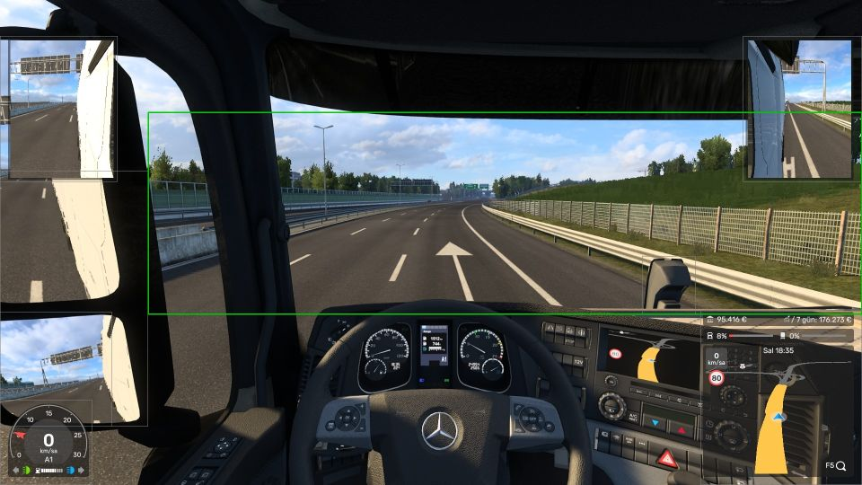
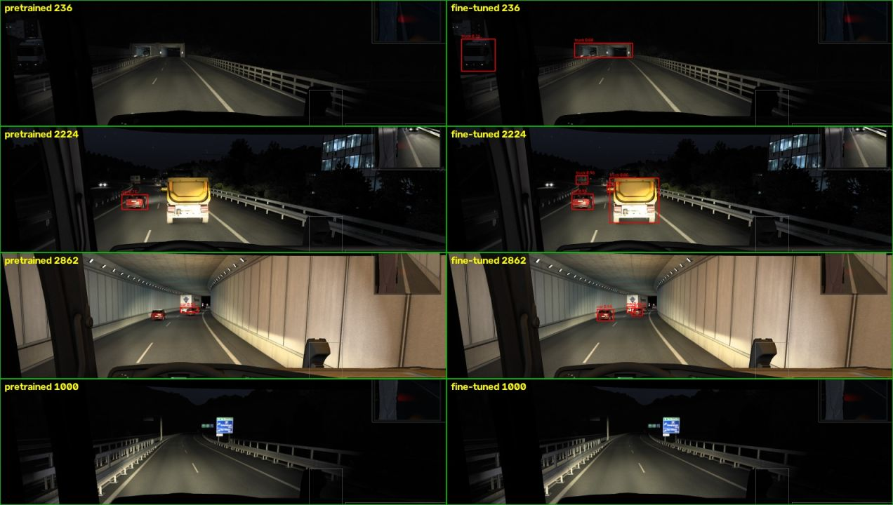

# Vehicle detection

**Date:** 2026-09-23
**Game:** ETS2 1.61.1.0, Linux native, X11, 1920×1080 windowed
**Machine:** i7-10750H, RTX 2060 6 GB, driver 595.91, ONNX Runtime 1.30 (CUDA 13)
**Code:** `core/perception/detection.py`, `core/perception/evaluation.py`,
`tools/{record,detect,export_detector,pseudo_label,train_detector,eval_detector}.py`

ADR-0007 explains why the model is D-FINE. In short: the pretrained nano
model missed three vehicles in four. Fine-tuning it on the game's own frames,
with labels from the largest D-FINE, brought that to one in four at the same
19 ms.

## What the detector is shown

The whole window is 1920×1080. The model is shown the green rectangle: the
road through the windscreen and the left door window, from just above the
horizon down to the dashboard. A detection that lies mostly (≥ 50 % of its
area) inside a grey rectangle is dropped. The grey rectangles are the game's
three mirror insets, the two real door mirrors and the HUD. A mirror shows
traffic *behind*, reversed left to right, and a car found there must never
become a lead vehicle.

The first version dropped a detection when its *centre* was in a grey
rectangle. That lost a car close alongside on the right: its centre sat on
the small door mirror, but most of it was visible through the windscreen.

The layout is `DEFAULT_CAB_VIEW`, measured for the default interior camera of
this truck. The rectangles are fractions of the frame, so any 16:9 window
size works. It is not robust to the camera moving. In one recording the
player looked around with the mouse, and the windscreen moved about 60 px
down.

## Data

Three drives by hand, recorded with `tools/record.py --images 10`, dusk into
night, Italian autostrada and a city:

| recording | length | images | used for |
|---|---|---|---|
| traffic-01 | 3 min | 1801 | training |
| city-01 | 5 min | 3001 | training |
| traffic-02 | 5 min | 3001 | **held out**: evaluation only |

The held-out drive never contributes a frame to training, so its frames do not
leak into the numbers below. Every second image was labelled; neighbouring
frames at 10 Hz are near copies.

### Labels

Nobody drew these labels by hand. `tools/pseudo_label.py` ran D-FINE xlarge
(obj365→COCO, Apache-2.0, 180 ms a frame) over every frame twice: once on the
whole windscreen, and once on the stretch around the horizon at twice the
magnification. The two passes were merged into one box per object. The
xlarge model found the distant vehicles the nano model missed; spot-checked
by eye, its boxes were right on every vehicle checked.

Three rules came out of looking at its labels:

- **Box by share, not centre**, for mirrors and the HUD (above).
- **Nested boxes.** The teacher sometimes boxed a van's roof as well as the
  van. A box ≥ 85 % inside a larger one that is about as certain (within 0.1)
  is dropped. The first version of this rule had no certainty condition, and
  a vague 0.35 box spanning the windscreen deleted the 0.87 cars inside it:
  13 % of the confident labels.
- **Whole-view boxes.** Both teacher and student sometimes box the whole
  dark windscreen, or a band of sky, as a car. A car that wide would be at the
  bumper, which means braking hard on an empty road. A box wider than 75 % of
  the crop (about a car two metres away) is dropped at decode time, for every
  model (`WHOLE_VIEW_SHARE`). 95 training labels were like this.

The teacher is not the truth. In one checked frame it missed a yellow car
close on the right front. The held-out drive also opens with 3 s of the
in-game map on screen, which gave one spurious "car" label out of 2159.

### Training

`tools/train_detector.py`: D-FINE nano from its COCO weights, keeping the
COCO class head. Game vehicles are labelled as the COCO class they are, so
the model has no classes to unlearn. Training used labels scoring ≥ 0.5,
2402 images and 4581 boxes; 12 epochs, batch 4, AdamW at 1e-4 (1e-5 for the
backbone), random mirroring and brightness. It took 37 minutes with the game
closed.

**Batch norm has to stay frozen.** The first full run updated batch-norm
statistics from batches of four. Every output score collapsed to about 0.03,
and at a 0.5 threshold the model found nothing. A 400-image check showed the
cause: with batch norm updating, the mean top score fell from 0.62 to 0.23;
frozen, it rose to 0.77.

## Result

Held-out drive (traffic-02), 1501 images, 2159 reference vehicles (teacher
boxes ≥ 0.5; cars, trucks, buses and motorcycles, matched regardless of kind
at IoU ≥ 0.5). `tools/eval_detector.py`:

| at threshold 0.5 | pretrained nano | **fine-tuned nano** |
|---|---|---|
| recall | 0.256 | **0.745** |
| precision | 0.945 | 0.830 |
| found, box < 16 px tall (far) | 3 % | 53 % |
| 16–32 px | 25 % | 73 % |
| 32–64 px | 47 % | 89 % |
| 64–128 px | 47 % | 97 % |
| ≥ 128 px (near) | **15 %** | **94 %** |
| median time per frame | 20 ms | 19 ms |

Lowering the pretrained model's threshold does not close the gap. At 0.35 it
reaches a recall of 0.43 at a precision of 0.69. The fine-tuned model at the
same threshold gets 0.79 at 0.79.

The row that matters most for following is the last one. The pretrained
model missed the rear of a dump truck 15 m ahead in most frames. The fine-tuned
model finds it:

*Left: pretrained, right: fine-tuned. Held-out frames: a tunnel portal
(where the fine-tuned model is wrong), the dump truck ahead, a lit tunnel, an
empty road.*

About half of the fine-tuned model's "false positives" are vehicles the
teacher also saw, but at under 0.5, so they are not in the reference: 184 of
388 on an earlier run of the same training. The precision above is therefore
a lower bound.

## Known failures

- **A tunnel portal seen as a truck**, 0.88, far ahead in the ego lane. For
  following, this is the dangerous kind: a phantom lead vehicle. Tracking over
  time and a distance estimate should catch it: the "truck" gets no nearer
  at a closing speed that would put it at the portal. Both are next on the
  perception list.
- Only dusk and night, one truck, one camera position, Italy. Daylight, rain
  and other countries are untested.
- The reference comes from a detector, so recall here means "as good as the
  teacher", not "every vehicle".

## Speed

With the game running on the same GPU, a 1080p frame takes 19–22 ms median
(p95 ≈ 30 ms), preprocessing included. Loading a model runs one inference on
zeros first. Without it, the first frame took 416 ms while CUDA set up.

## Signal heads too (7 October 2026)

The fine-tuned nano had stopped finding traffic lights: COCO has the class,
and the training frames' signal heads, unlabelled, taught it they were
background -- on the held-out black-box pictures it found none of 394. The
lights were read from colour alone, and every red thing needed a rule of its
own; short of Linz a filling station's logo stopped the truck
(docs/results/traffic_lights.md, "Inside a head").

Retrained the same way with the teacher's `traffic light` boxes kept:
`tools/pseudo_label.py` over the eight recordings with images (5555 frames)
and, with `--snapshots`, the 2071 black-box pictures of the missions so far
(half size, taken braking and waiting at lights across Italy, Switzerland,
Austria and Scandinavia). Held out: `traffic-02` and the Bern–Linz session
(20261006-130701). 5663 training frames, 13193 boxes, 12 epochs, 72 minutes.

Vehicles, held-out `traffic-02`, threshold 0.5:

| | precision | recall | 0-16 px | 16-32 px | median |
|---|---|---|---|---|---|
| vehicles only (`dfine-nano-ets2-vehicles`) | 0.830 | 0.745 | 53 % | 73 % | 17.7 ms |
| with signal heads (`dfine-nano-ets2`) | 0.797 | 0.820 | 67 % | 81 % | 16.5 ms |

Signal heads, held-out Bern–Linz pictures (half size), threshold 0.5:
precision 0.756, recall 0.424 -- 85 % of heads 32-64 px tall, 62 % of
16-32, 27 % under 16. `traffic-02` has 20 "traffic light" labels, most of
them the teacher's mistakes (a gantry sign 467 px wide), and says nothing.
Heads are kept from 0.25 (`HEAD_THRESHOLD`): approaching a red in Milan the
head round its lamp scored 0.40 and 0.26 at 40 and 35 m.
